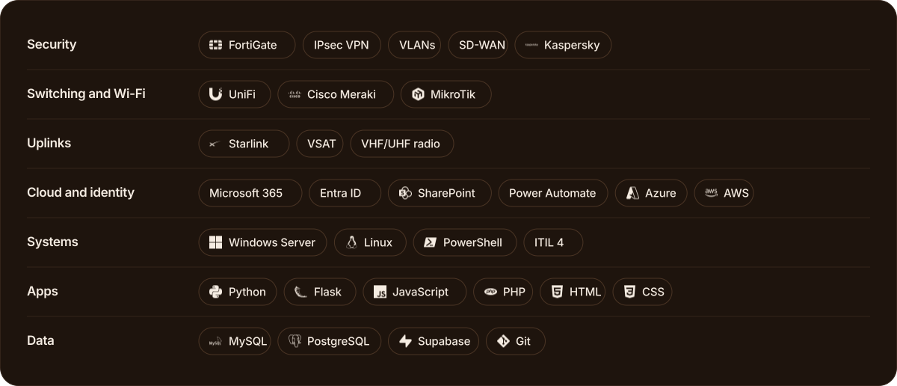

<picture>
  <source media="(max-width: 700px) and (prefers-color-scheme: light)" srcset="https://raw.githubusercontent.com/Abelbinkandanda/Abelbinkandanda/main/assets/hero-mobile-light.svg" />
  <source media="(max-width: 700px)" srcset="https://raw.githubusercontent.com/Abelbinkandanda/Abelbinkandanda/main/assets/hero-mobile.svg" />
  <source media="(prefers-color-scheme: light)" srcset="https://raw.githubusercontent.com/Abelbinkandanda/Abelbinkandanda/main/assets/hero-light.svg" />
  
</picture>

I run networks, security and IT for humanitarian missions in DR Congo. Often on sites built in days. Far from any fiber.

Today, I lead IT and telecoms for MSF France across the country. And when spreadsheets fall short, I build the tools my team needs.

### The toolkit.

<picture>
  <source media="(max-width: 700px) and (prefers-color-scheme: light)" srcset="https://raw.githubusercontent.com/Abelbinkandanda/Abelbinkandanda/main/assets/toolkit-mobile-light.svg" />
  <source media="(max-width: 700px)" srcset="https://raw.githubusercontent.com/Abelbinkandanda/Abelbinkandanda/main/assets/toolkit-mobile.svg" />
  <source media="(prefers-color-scheme: light)" srcset="https://raw.githubusercontent.com/Abelbinkandanda/Abelbinkandanda/main/assets/toolkit-light.svg" />
  
</picture>

### The path.

1. **Vodacom Congo.** A mobile network, watched around the clock from the Goma NOC.
2. **Danish Refugee Council.** Eight humanitarian bases in North Kivu and Ituri. More than 200 users.
3. **MSF France.** Since March 2025. IT and telecoms lead for the DRC mission. 400+ users, and the IT side of the Ebola response.

Networks and Telecommunications degree, ISIG Goma. French, Swahili, English and Lingala. Now learning cybersecurity, cloud and automation.

### Activity.

  <picture>
    <source media="(prefers-color-scheme: light)" srcset="https://github-readme-stats.vercel.app/api?username=Abelbinkandanda&show_icons=true&count_private=true&hide_border=true&border_radius=20&bg_color=F4EBDF&title_color=24160C&icon_color=9E5619&text_color=6B5444&ring_color=9E5619" />
    
  </picture>
  <picture>
    <source media="(prefers-color-scheme: light)" srcset="https://streak-stats.demolab.com?user=Abelbinkandanda&hide_border=true&border_radius=20&background=F4EBDF&ring=9E5619&fire=9E5619&currStreakNum=24160C&sideNums=24160C&currStreakLabel=9E5619&sideLabels=6B5444&dates=6B5444&stroke=D9C8B6" />
    
  </picture>

<picture>
  <source media="(prefers-color-scheme: light)" srcset="https://raw.githubusercontent.com/Abelbinkandanda/Abelbinkandanda/output/github-snake.svg" />
  
</picture>

### Let's talk.

Based in Goma. Open to missions and freelance work.

[Email](mailto:ilungakandandaabel@gmail.com) &nbsp;&nbsp; [LinkedIn](https://www.linkedin.com/in/abel-ilunga-kandanda-9581981a6/) &nbsp;&nbsp; [Upwork](https://www.upwork.com/freelancers/~01b8e703d3ef3a7b47) &nbsp;&nbsp; [Portfolio](https://abelbinkandanda.github.io)
